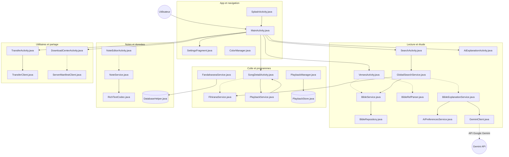

# 📖 Baiboly

> *« Fa velona sy mahery ny tenin'Andriamanitra ka maranitra noho ny sabatra roa lela »*
> — **Hebreo 4:12**

Baiboly est une application Android complète d'étude biblique en **malgache** : lecture de la Bible, recherche globale, cantiques avec playback audio, notes personnelles, programmes de culte, Mofonaina quotidien, explications par IA et transfert de données entre appareils — le tout pensé pour marcher **hors ligne** autant que possible.

---

## ✨ Fonctionnalités

### 📜 Lecture et étude (Scripture and study)
- **Lecteur biblique** (`VersesActivity`) — navigation fluide par livre et chapitre, avec parsing intelligent des références bibliques (`BibleRefParser`, `ReadingParser`).
- **Recherche globale** (`SearchActivity`) — un seul écran pour chercher dans les **versets** et les **cantiques** (`GlobalSearchService`).
- **Fanazavana AI** (`AiExplanationActivity`) — chat d'explication de versets propulsé par **Google Gemini** (`GeminiClient`), avec préférences dédiées (`AiPreferencesService`) et rendu Markdown.

### 🎵 Culte et programmes (Worship and programs)
- **Fihirana / cantiques** (`SongListActivity`, `SongDetailActivity`, `SolfaActivity`) — textes de chants et solfège (`FihiranaService`, `SongParser`).
- **Lecture audio** — `PlaybackService` en **foreground service** (type `mediaPlayback`), piloté par `PlaybackManager` avec persistance d'état (`PlaybackStore`). L'utilisateur peut ajouter ses propres playbacks (`AddPlayBackActivity`).
- **Fandaharana / programmes** (`FandaharanaActivity`, `ProgramDetailActivity`) — gestion des programmes, adossée à la base de données locale.

### ✍️ Notes et données (Data and services)
- **Fanamarihana / notes** (`NotesActivity`, `NoteEditorActivity`) — éditeur de notes enrichies encodées via `RichTextCodec`, service dédié `NoteService`.
- **Historique de lecture** (`HistoryManageActivity`, `HistoryRepository`) — suivi des passages déjà utilisés.
- **Base de données locale** (`DatabaseHelper`) — stockage hors ligne de toutes ces données.

### 🌅 Mofonaina
- `MofonainaActivity`, `MofonainaCalendarActivity`, `MofonainaYearlyListActivity` — lectures quotidiennes, calendrier mensuel et liste annuelle.
- `AinaOfDayActivity` — rubrique *Aina sy Fahasalamana*.
- Contenu disponible **en ligne** (scraping via `MofonainaScraper` avec Jsoup) **et hors ligne** (`MofonainaRepository`, `MofonainaCache`).

### 🤖 Fanekempinoana
- `FanekenaActivity` — consultation des conventions/alliances avec contenu récupéré par `FanekenaRepository` / `FanekenaService`.

### 🔧 Utilitaires et partage (Utilities and sharing)
- **Download center** (`DownloadCenterActivity`) — catalogue de contenus téléchargeables et **mise à jour de l'application** via `ServerManifestClient`, avec `DownloadHistoryStore`, partage des fichiers et installation d'APK directement depuis l'écran.
- **Transferto (WiFi)** (`TransferActivity`) — transfert de données entre appareils via un **serveur HTTP embarqué NanoHttpd** (`TransferClient`, `TransferUtils`), connexion par **QR code** (ZXing, capture forcée en portrait).

### 🏠 Widgets
- Deux widgets pour l'écran d'accueil : `MofonainaOnlineWidget` et `MofonainaOfflineWidget`, pour lire le texte du jour sans ouvrir l'app.

---

## 🏛 Architecture

Vue d'ensemble (générée avec [gitdiagram](https://gitdiagram.com/mrfanasina/baiboly)) — chaque nœud correspond à un fichier source du dépôt :



## 🧱 Structure du projet

```
app/src/main/
├── AndroidManifest.xml
├── assets/
│   └── extract.py              # script auxiliaire d'extraction de données
└── java/com/fa/baiboly/
    ├── SplashActivity.java     # splash animé + verset aléatoire
    ├── MainActivity.java       # shell de navigation principal
    ├── SettingsFragment.java   # réglages utilisateur
    ├── data/
    │   ├── ColorManager.java
    │   ├── DatabaseHelper.java
    │   ├── ai/                 # BibleExplanationService, GeminiClient, AiPreferencesService
    │   ├── bible/              # BibleService, BibleRepository
    │   ├── fihirana/           # gestion des cantiques
    │   ├── fanekena/           # FanekenaRepository, FanekenaService
    │   ├── fandaharana/        # FandaharanaService (programmes)
    │   ├── notes/              # NoteService + richtext/RichTextCodec
    │   ├── playback/           # PlaybackService, PlaybackManager, PlaybackStore
    │   ├── search/             # GlobalSearchService
    │   ├── mofonaina/          # MofonainaRepository + cache
    │   ├── scraper/            # MofonainaScraper
    │   ├── parser/             # BibleRefParser, ReadingParser, SongParser
    │   ├── history/            # HistoryRepository
    │   ├── download/           # ServerManifestClient, DownloadHistoryStore, DownloadEntry
    │   └── transfer/           # TransferClient, TransferUtils
    ├── widgets/                # MofonainaOnlineWidget, MofonainaOfflineWidget
    └── ui/                     # activités et adapters
        ├── ai/                 # AiExplanationActivity
        ├── baiboly/ home/      # écrans d'accueil
        ├── reader/ verses/     # lecture biblique (VersesActivity)
        ├── fihirana/           # SongListActivity, SongDetailActivity, SolfaActivity…
        ├── mofonaina/          # MofonainaActivity, calendriers, AinaOfDayActivity
        ├── fanekena/ notes/ search/ settings/
        ├── fandaharana/ history/ download/ transfer/
        └── MenuHelper.java
```

---

## 🚀 Compilation et installation

### Prérequis
- **Android Studio** récent (SDK 36)
- **JDK 11+**
- Une clé API **Google Gemini** pour la fonction *Fanazavana AI* (optionnelle — le reste de l'app fonctionne sans)

### Configuration de la clé Gemini

La clé est lue depuis `local.properties` (jamais commitée) :

```properties
# local.properties, à la racine du projet
GEMINI_API_KEY=votre_cle_api_ici
```

Elle est injectée comme `buildConfigField` et lue au runtime via `BuildConfig.GEMINI_API_KEY`. Sans clé, la fonction d'explication IA reste inactive.

### Compiler

```bash
# Version debug
./gradlew assembleDebug

# Version release
./gradlew assembleRelease
```

L'APK est généré dans `app/build/outputs/apk/`.

### Installer sur un appareil

```bash
./gradlew installDebug
```

---

## 🔑 Permissions Android principales

| Permission | Usage |
|---|---|
| `INTERNET` | Mofonaina en ligne, explications Gemini, catalogue de mises à jour |
| `FOREGROUND_SERVICE` + `FOREGROUND_SERVICE_MEDIA_PLAYBACK` | Lecture audio en arrière-plan |
| `CAMERA` | Scan du QR code dans *Transferto* |
| `CHANGE_WIFI_STATE`, `ACCESS_WIFI_STATE`, `ACCESS_NETWORK_STATE`, `ACCESS_FINE_LOCATION`, `NEARBY_WIFI_DEVICES` | Transfert WiFi direct |
| `REQUEST_INSTALL_PACKAGES` | Installation de l'APK de mise à jour depuis l'écran Downloads |
| `WAKE_LOCK` | Lecteur audio et tâches de fond |

---

## 📚 Dépendances principales

| Librairie | Rôle |
|---|---|
| `androidx.appcompat`, `material`, `constraintlayout` | UI de base |
| `androidx.navigation` (`fragment` + `ui`) | Navigation in-app |
| `androidx.media` | Lecteur audio |
| `androidx.work:work-runtime` | Tâches asynchrones |
| `androidx.viewpager2`, `swiperefreshlayout`, `cardview`, `documentfile`, `webkit` | UX générale |
| `org.jsoup:jsoup` | Scraping du contenu Mofonaina |
| `com.google.ai.client.generativeai:generativeai` | SDK Google Gemini (explications IA) |
| `io.noties.markwon` (+ `ext-tables`) | Rendu Markdown dans le chat IA |
| `org.nanohttpd:nanohttpd` | Serveur HTTP embarqué (transfert WiFi) |
| `com.google.zxing` + `zxing-android-embedded` | Génération / scan de QR codes |
| `com.google.guava:guava` | Utilitaires asynchrones Java |

---

## 🎨 Thèmes et apparence

- Par défaut, l'app suit le mode de l'appareil (`MODE_NIGHT_FOLLOW_SYSTEM`).
- L'utilisateur peut forcer le mode clair ou sombre et choisir ses couleurs de base via `ColorManager`, appliqué globalement (y compris dès le `SplashActivity`).

---

## 🏗 Stack technique

- **Langage** : Java 11 (aucun Kotlin)
- **UI** : Android Views + ViewBinding
- **Min SDK** : 23 · **Target/Compile SDK** : 36
- **Build** : Gradle (Kotlin DSL) avec version catalog

---

## 🤝 Contribuer

1. **Fork** du dépôt
2. Créez une branche (`feature/ma-fonctionnalite`)
3. **Commit** avec des messages clairs
4. **Pull Request** avec description du changement

---

## 📄 Licence

Projet à but de service — voir le dépôt [mrfanasina/baiboly](https://github.com/mrfanasina/baiboly) pour les détails de licence.

---

<p align="center"><i>« Ny tenin'Andriamanitra dia velona sy mahery, maranitra noho ny sabatra roa lela. »</i> — Hebreo 4:12</p>
